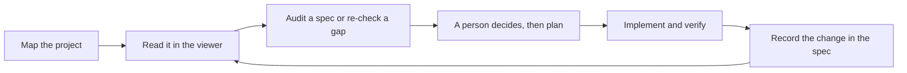

# Working with the skills

A useful sequence is:



`project-knowledge` never changes application code. Your coding agent does that, and then records the change in the spec as a small edit ([keeping the spec current](#keeping-the-spec-current)). Reading a test establishes what it expects; only running it produces a test result.

## What it is good for

- **Onboarding:** follow a workflow across UI, API, policy, persistence and tests without rediscovering the same paths every session.
- **Change planning:** see which rules and related areas a change can affect before writing code.
- **Rules you can point at:** a reviewer, a tester or a support person can say "BR-CANCEL-02 is wrong" instead of describing a screen.
- **Useful gap reports:** each doubt is its own page, typed as a missing capability, outdated documentation, an unverified scenario, a conflict or an undecided product proposal, and carries who re-checked it and who decided it.
- **Team memory:** commit the notes with the project. A manual sync reviews changes from all contributors since the last reviewed commit, including older commits and merges.

The graph records relationships between explanations. It does not infer a complete runtime dependency graph or prove that the deployed application works. The agent never records a decision nobody made: accepting, rejecting or deferring a gap is a person's act.

## Example prompts

These work in any host; use `$name` or `/name` where your host supports it, or just say which skill you mean.

```text
Use the project-knowledge skill to build an English knowledge vault for this repository.
Describe only what the code does: one page per feature with its business rules,
each claim linked to source, and every doubt as its own gap.
```

```text
Use the project-knowledge skill to audit docs/checkout.md against the checkout implementation.
Prioritize real mismatches; record each as a separate open gap.
```

```text
Use the project-knowledge skill to re-check the gap "cancelled order still reserves stock".
Read the call path and relevant tests, write the result into the gap's Recheck
section, and leave the decision to me.
```

```text
Use the project-knowledge skill to plan the accepted gap "reservation-release".
Include affected modules, concurrency checks and acceptance criteria. Plan only.
```

```text
Use the project-knowledge skill to record this change in the spec:
only the rules I changed, and keep their numbers.
```

```text
Use the project-knowledge skill to record what changed in the last week.
```

## Try the example first

[Parcel Desk](../examples/parcel-desk/README.md) is a small, fictional pickup service with a real spec/code disagreement and a ready-made knowledge vault. The vault shows three gaps at different points of the lifecycle (needs recheck, needs decision, accepted with a plan). It includes example audit, investigation and plan outputs.

```sh
git clone https://github.com/nikomistar/project-spec-skills.git
cd project-spec-skills
python3 scripts/verify.py
```

Start the viewer on the example:

```sh
python3 skills/project-knowledge/scripts/knowledge.py serve --repo examples/parcel-desk --open
```

Search for **cancellation**, open a gap, follow its links and try "Copy for AI" on it. [The viewer](viewer.md) describes every screen.

To use Obsidian, choose **Open folder as vault** and select `examples/parcel-desk/knowledge/parcel-desk`. Open `00-index`, then **Graph view: Open graph view** from the command palette (Cmd/Ctrl+G). In graph settings, **Existing files only** hides unresolved source links outside the vault. Pages cluster around their area because each page links to it; run pages carry no links, so they do not pull the clusters together. To see the spec alone, put `-path:gaps -path:plans -path:runs` in the graph's search filter, and add a color group per folder (`path:areas`, `path:notes`, `path:gaps`) under **Groups**. **Open local graph** shows only the neighbours of the page you are reading. Gap properties are searchable, for example `[decision:open]` or `[kind:verification-gap]`. See [Obsidian's graph guide](https://help.obsidian.md/plugins/graph).

Source links point outside the vault into the repository. Some hosts do not open these paths; the note's `sources` property gives the repository-relative path for your editor. All example application data is invented.

## Keeping the spec current

There are three ways, from the cheapest to the most thorough. Most projects need the first one day to day and the third now and then.

**1. With every change.** Whoever changes the code corrects the spec in the same task: only the rules that changed, each keeping its number. A changed validation message is one row of one table. To make every agent in the repository do this, add the short block to the file it reads at the start of a session:

```sh
npx project-spec instructions --file AGENTS.md      # or CLAUDE.md, GEMINI.md, .cursor/rules/project-spec.mdc
```

Or ask for it once, at the end of a task:

```text
Use the project-knowledge skill to record this change in the spec.
```

**2. For a pull request or a period.** When changes came from people or agents that did not touch the spec:

```text
Use the project-knowledge skill to record what changed in the last week.
```

The agent reads that diff, not the project, and edits the pages of the features it touched.

**3. A full sync.** Everything since the last reviewed commit, every changed file accounted for, with a receipt:

```text
Use the project-knowledge skill to sync: review all integrated changes since the last
reviewed checkpoint, update the affected spec notes, and revisit gaps whose
sources changed.
```

Pages already corrected by the first two ways cost a sync almost nothing: it sees that their sources were reviewed after the change.

Or narrow the work:

```text
Ask project-knowledge to explore permissions and deepen the access-control notes.
Ask project-knowledge to work the gaps: re-verify open ones against the current code
and list which are waiting for my decision.
Ask project-knowledge to check links and source freshness.
```

The agent researches and writes the claims. The Python helpers validate structure, track source fingerprints and render views; running a helper alone does not understand your code. A scan identifies candidate changes, and fingerprints are accepted and the Git checkpoint advanced only after review. See the [sync workflow](../skills/project-knowledge/references/sync.md). If part of the range cannot be accepted yet, for example because another contributor has uncommitted edits to a file, mark it `deferred`: the rest is accepted, the checkpoint stays where it is and the helper exits with status 3 (not 0, and not 2, which is a usage error).

If `check` fails on a vault written before the spec/gap split, follow the [migration guide](../skills/project-knowledge/references/migrate.md). The same guide has the regroup pass for a vault whose feature pages lack the sections above, or whose rules were spread over separate table pages per kind.

Everything is manual and nothing is published: the package installs no schedule or hooks, writes the block for agents only when you run the command, and does not commit, push or synchronize other clones. Share the Markdown, reviewed state and chosen skill version through your normal Git workflow. Personal Obsidian settings and local scan reports should stay ignored.

## Reviewing one topic

The map writes down what the product does and raises the doubts it meets on the way. A review is a separate pass for the moment you want one topic looked at on purpose: the agent goes through every way into the product again with a fixed list of questions, so nothing is skipped because it looked fine.

```text
Use the project-knowledge skill in review mode: review the product for security.
Go by the inventory file, one feature at a time, and ask every question of the
review guide of every entry point. Read the code and run nothing. Write each doubt
as its own gap with topic security, and tell me how many features you reviewed.
```

| Topic | What it asks |
| --- | --- |
| `security` | Who can reach each entry point and where the server checks it, whose record it is, another way to the same action that skips the check, steps that can be skipped, which fields may be changed, what comes back, what is done with input, who can fetch a file, sign-in and recovery, secrets, webhooks, jobs, what is sent out, money. |
| `abuse` | What a signed-in member can do too much of, followed from the request to where it ends up: how big a text, a list, an import or a file may be, what one request costs the server, what the server believes because the caller said it, how many and how often per account, what goes to storage past the server, paid work, how many messages it can make the product send and how often one person gets them, what a failed upload leaves behind, what other people are served. |
| `validation` | The same field in the form, on the server and in the database: a check only the form has, different limits, required in one place and optional in another, an import or an admin screen that skips the rules, a refusal that does not say which field. |
| `data` | The states of each kind of record, what a delete leaves behind, several writes with no transaction, two people saving at once, rules kept only in code, copies of one fact, money and time zones. |
| `api` | Endpoints nothing calls, clients calling what does not exist, two ways to do one thing, calls marked as outdated and still used, unchecked input, inconsistent names and errors, a written contract that disagrees with the code, calls out without a timeout. |
| `ui` | Missing loading, empty, error and no-permission states, the same control built twice, one thing under two names, actions without a confirmation, a control shown to someone the server refuses, differences between clients. |
| `failures` | What happens when another service is down or a job fails: timeouts, retries, where the work goes after the last attempt, errors that are dropped, a job that stops in the middle, a missing setting. |

The full lists are in [the review guide](../skills/project-knowledge/references/review.md). Name another topic ("data", "performance", "texts") and the agent proposes its questions before it starts.

What comes out:

- **Rules.** What the code answers plainly goes onto the feature's page as a numbered rule. A security review also fills in who may use each feature (`access`), which the viewer shows beside the title.
- **Gaps.** Each doubt is one gap with its topic, in the same queue as the others. Filter the queue by topic to see only those.
- **A run page** with the features reviewed and not reviewed, so a later session continues where this one stopped.

### What was checked, and what was not

The viewer's first page has a block for this: the map with the share of features finished, then one line per review with the day of its last run, how many features it covered and how many of its gaps are open, and "Not run yet" with the request to copy for the others. An agent answers the same in the chat, from the files:

```text
Use project-knowledge: what is the status of the spec?
```

It runs `npx project-spec summary`, which you can run yourself:

```text
spec: project-spec; 8 areas, 64 feature and reference pages, 57 gaps
map: 31 of 40 features finished (78%), 1 in progress, 8 not started
pages: 6 partial, 4 with code changed since the last check
gaps: 49 open (needs recheck 30, needs decision 16, accepted 2, deferred 1), 8 closed
open gaps by topic: security 12 (3 high), ui 5, logic 9 (1 high), no topic 23
reviews:
  security   last run 2026-11-20, 31 of 31 features; project-spec/runs/2026-11-20-review-security.md; 12 open gaps with topic security
  validation not run; 0 open gaps with topic validation
```

`npx project-spec gaps --topic security --priority high` lists the gaps one filter leaves, the most urgent first, each with its file, so an agent can be asked for "the high security gaps" without opening the viewer.

A review opens every entry point again, so it takes about as long as the map of the features it covers. Run one topic at a time, and name an area or "what changed last week" to keep it short. It reads code: vulnerable or outdated packages, secrets in the Git history and server configuration are for tools (`npm audit`, `osv-scanner`, a secret scanner), and the report names what it did not cover. Security gaps describe weaknesses of a live product, so think before you publish the vault where people outside the team can read it.

## Gaps are decided by people

A gap starts open. Anyone can re-check it (ask `project-knowledge` to recheck it) and the result is written into the gap with who did it and when. Then a person accepts, rejects or defers it, or the agent finds the code already closes it and marks it done. Only an accepted gap gets a plan. Each gap page has its own `Discussion` and `Decision` sections, and the viewer lists the queue by state. A recheck means the same thing for every kind of gap, proposals included: it asks only whether the page's description of current behavior still holds in the code ("confirmed (still holds)" or "not reproduced (no longer holds)"), never whether the proposal is a good idea. Details are in [gaps.md](../skills/project-knowledge/references/gaps.md).

## When two people update the vault

```text
Use the project-knowledge skill to merge our knowledge updates from main
and teammate/knowledge. Preserve both contributors' useful pages and stable IDs,
check overlapping claims against source, and report unresolved conflicts.
```

The agent compares the common base and both versions, combines supported changes, and retains unresolved claims with their provenance. If two people recorded different decisions on the same gap, it reopens that gap, keeps both positions in its discussion and reports it. A read-only inspector finds changed paths, overlaps and ID collisions. Reviewed fingerprints and Git checkpoints need explicit reconciliation; they are never made current by picking the newest JSON. Derived views are rebuilt from the resolved pages. See the [merge workflow](../skills/project-knowledge/references/merge.md).

Use separate branches or worktrees, or one writer per page, for concurrent work. The local finish lock protects bookkeeping, not simultaneous editing across computers. Merge is an agent workflow, not an automatic Git merge driver.
